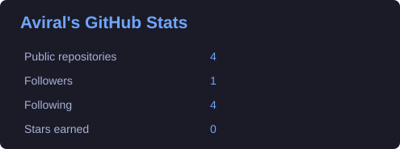
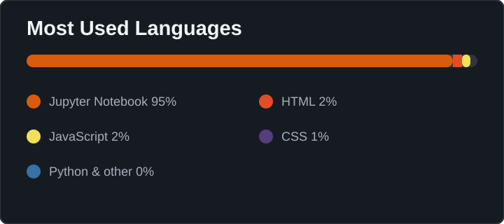

<div align="center">


</div>

<br/>

<div align="center">

[](https://git.io/typing-svg)

</div>

<br/>

<div align="center">

[](https://www.linkedin.com/in/aviral-agarwal-97380b327/)
[](https://github.com/Aviral02728)
[](mailto:aviral27nov@gmail.com)

</div>

---


## 🧑‍💻 About Me

```python
class AviralAgarwal:
    def __init__(self):
        self.name = "Aviral Agarwal"
        self.location = "India 🇮🇳"
        self.education = "B.Tech CSE | JIIT"
        self.interests = [
            "Full Stack Development",
            "Data Science",
            "Machine Learning",
            "Artificial Intelligence",
            "Data Structures & Algorithms"
        ]
        self.languages = [
            "C", "C++", "Python",
            "Java", "JavaScript", "SQL"
        ]
        self.currently_learning = [
            "Data Analytics",
            "Machine Learning",
            "Full Stack Development"
        ]
        self.open_to = [
            "Internships",
            "Collaborations",
            "Open Source"
        ]

    def motto(self):
        return "Learn. Build. Analyze. Improve."


me = AviralAgarwal()
```

- 🎓 Pursuing **B.Tech in Computer Science and Engineering at JIIT**
- 💻 Interested in **Full Stack Development and Software Engineering**
- 📊 Exploring **Data Science, Data Analytics, and Machine Learning**
- 🧠 Passionate about programming, problem-solving, and AI
- 🚀 Building technical skills through hands-on learning
- 🤝 Open to internships, collaborations, and open-source opportunities

<br clear="right"/>

---

## 🏆 Achievements

- 🥇 **KrakenX 2026 — 1st Place**

---

## 📂 Featured Repository

- [**aviral_main**](https://github.com/Aviral02728/aviral_main) — My GitHub profile and project overview

---

## 💻 Programming Languages

<div align="center">


</div>

---

## 🛠️ Tech Stack

<div align="center">

### 🌐 Full Stack Development


### 🗄️ Databases


### 📊 Data Science & Machine Learning


### ⚙️ Tools & Platforms


</div>

---

## 📊 GitHub Statistics

<div align="center">





<br/><br/>


</div>

---

## 🐍 Contribution Snake

<div align="center">


</div>

---

<div align="center">

### 💡 Daily Inspiration

<!-- DAILY-QUOTE:START -->
> "Stay hungry, stay foolish."  
> — **Steve Jobs**
<!-- DAILY-QUOTE:END -->

<br/>

### 🌱 Always Learning. Always Improving.

*Thanks for visiting my profile! Let's connect and build something meaningful.*


</div>
